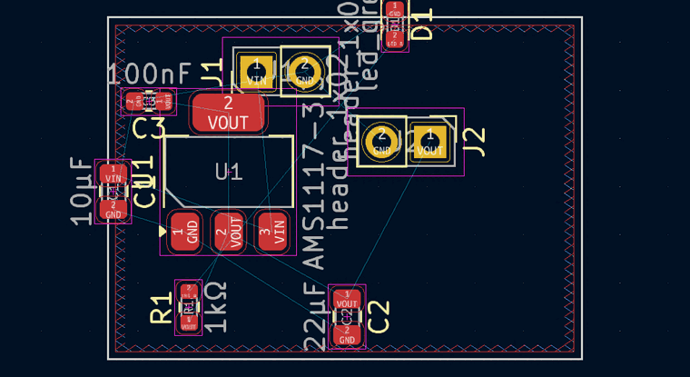
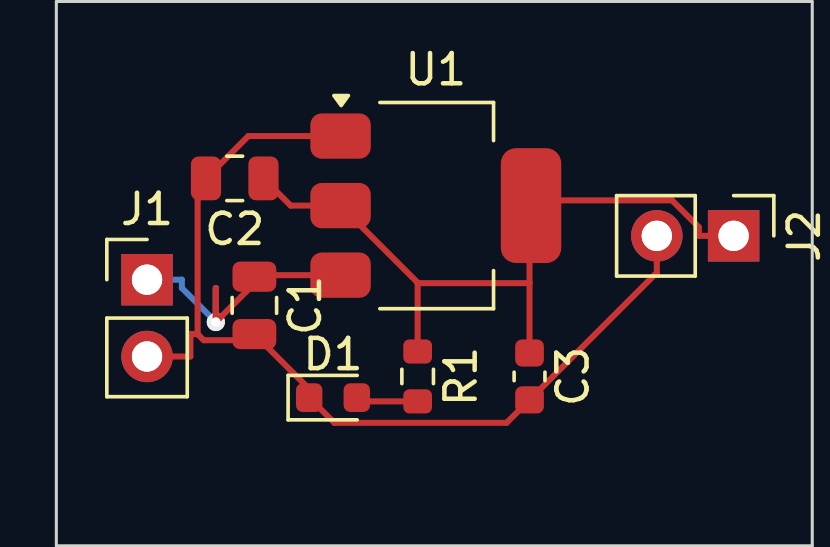

# PCBAgent

**One sentence in, a checked board out. Nothing leaves your machine.**

PCBAgent takes a circuit request in plain language, such as *"convert a 5 V USB supply to 3.3 V for up to
500 mA, with a power-on LED"*. It writes a specification, designs the circuit, and verifies it in ngspice
at every tolerance corner. It then sources every part from a local JLCPCB catalog and lays out and routes
a two-layer KiCad board that passes KiCad's design-rule check. Gerbers, drill files, BOM and pick-and-place
come out the other end.

The model chooses. The tools decide what is true. A local LLM (Nemotron through Ollama by default) only
writes JSON: the spec, the circuit and placement constraints. ngspice measures, the catalog says what is
orderable, a placer and Freerouting draw the copper, and KiCad's DRC scores the result.



## Why local

A schematic *is* the product's IP. Its topology, the unusual part combinations, the custom interfaces and
the constraint strategy all leak the design before launch. Cloud AI EDA tools need that data on someone
else's servers. PCBAgent runs the whole lifecycle on your machine: the model, the simulator, the parts
database, the autorouter and KiCad. There are only two network calls, both explicit and both public data:
a one-time parts-list download and a one-time model pull. See [Privacy](#privacy-and-the-air-gap) for what
we checked and found.

## What it does

```
request ──► spec (locked) ──► circuit JSON ──► ngspice × tolerance corners ──► ratings + datasheet rules
                                    ▲                                                   │
                                    └──────────── model revises on failure ◄────────────┤ pass
                                                                                        ▼
board ◄── KiCad DRC ◄── Freerouting ◄── placer ◄── constraints ◄── KiCad netlist ◄── JLCPCB catalog
  │
  └──► Gerbers + drill (zip), JLCPCB BOM + CPL, replay in KiCad
```

1. **Specify.** `pcb_spec` writes a spec with ports, test conditions (ideal sources and loads), and
   requirements with numeric bounds. It is then **locked by SHA-256**. Every later step re-checks the hash,
   so a failing design cannot pass by loosening its own requirements. Only a human can unlock it.
2. **Design and simulate.** The model writes the circuit as JSON (components → part model → pins → nets),
   not code. PCBAgent generates the SPICE deck itself and wraps the board in a test bench built from the
   spec. Every pin gets a current sense, so per-part power and stress come out of the simulation. ngspice
   runs every condition at every tolerance corner (exhaustive up to 8 varying parameters, sampled beyond).
3. **Verify.** A requirement passes only if *every* corner is inside its bounds. Each number in the report
   cites the raw file it came from, with that file's SHA-256 and the vectors used. On top of the spec,
   the operating point is checked against datasheet limits (junction temperature, regulator current,
   diode current, and so on). Datasheet topology rules are checked too: AMS1117 needs ≥ 22 µF on its
   output, and AP2112K's EN pin must not float. A miss goes back to the model with the measured values,
   and the model revises the circuit.
4. **Source.** Each part is matched against a local JLCPCB catalog: exact value; tolerance no worse than
   verification assumed; power, voltage and current ratings above the simulated worst case with derating;
   and enough stock. Basic parts win, then preferred, then price. Footprints and symbols are checked against
   your installed KiCad libraries. The same connections become a KiCad netlist, a KiCad schematic and a
   JLCPCB BOM.
5. **Lay out.** `pcb_layout` takes placement constraints, never coordinates: "C1 near U1's IN pin",
   "J1 on the left edge", "J1 → U1 → J2 left to right". Datasheet capacitors and connectors get their
   constraints automatically. A deterministic simulated-annealing placer positions the parts. Track widths
   come from the simulated net currents (IPC-2221). Freerouting draws the copper, ground pours are added,
   and KiCad's DRC must report 0 errors and 0 unconnected items.
6. **Watch and build.** The `layout/` folder is a normal KiCad project (`.kicad_pro`, `.kicad_sch`,
   `.kicad_pcb`), with every footprint linked to its schematic symbol. The placement and routing are
   recorded: `pcbagent replay` opens the board in KiCad's PCB editor and plays the whole sequence back
   with no clicks. `pcbagent fab` writes Gerbers, drill, BOM and CPL.

After the first prompt the run continues on its own. Whenever the model stops early, the Pi extension (or
the standalone loop) reads the design state and pushes the model to the next step. That continues until
the board is DRC-clean, the attempt budget runs out, or you press Escape.



## Quick start

### 1. Toolchain

| Tool | Why | Install |
|---|---|---|
| Python ≥ 3.10 | the runners (stdlib only: no pip dependencies) | system |
| ngspice | simulation | `apt install ngspice` · `brew install ngspice` |
| KiCad 7, 8 or 9 | libraries, board, DRC, Gerbers | kicad.org |
| Java 21 + Freerouting 2.x jar | autorouting | jar into `~/.pcbagent/tools/` from github.com/freerouting/freerouting/releases |
| Ollama + a tool-calling model | the LLM | `ollama pull nemotron-3-nano` (or another Nemotron or tool-calling model) |
| Node 20+ and Pi | the agent UI (optional) | `npm i -g @earendil-works/pi-coding-agent` |

```bash
git clone <this repo> pcbagent && cd pcbagent
pip install -e .            # or: export PYTHONPATH=$PWD/src
pcbagent doctor             # checks every tool and the privacy settings
pcbagent catalog update     # one-time public download: JLCPCB basic/preferred parts (~3 MB)
```

`catalog update` fetches the daily CDFER snapshot of JLCPCB's basic and preferred parts (derived from
yaqwsx/jlcparts). `--full` gets the ~1 GB in-stock database. On an air-gapped machine, download the file
elsewhere and run `pcbagent catalog import <file>`. JLCPCB's own parts CSV export and jlcparts SQLite
databases are also accepted.

### 2. See the pipeline without any LLM

```bash
pcbagent demo ldo --fab --watch     # or: divider, led_indicator, rc_filter, lipo_3v3
```

| Example | What it exercises |
|---|---|
| `divider` | 5 V → 3.3 V ADC scaling with the ADC's input impedance as the load |
| `ldo` | AMS1117 regulator at 500 mA: dropout at 4.75 V input, load regulation, junction temperature |
| `led_indicator` | LED current held to 2–4 mA across LED forward-voltage spread and resistor tolerance |
| `rc_filter` | AC analysis: −3 dB corner and stopband attenuation, with capacitor tolerance corners |
| `lipo_3v3` | XC6206 from a LiPo cell: low-battery dropout, µA sleep current, JST PH battery connector |

This runs the bundled example's spec, circuit and constraints through simulation, verification, sourcing,
placement, routing, DRC and fab export, then replays the layout in KiCad. Without a catalog it falls back
to a clearly labelled **SAMPLE** catalog of fake part numbers so the demo still runs; don't order from it.

### 3. Design with Pi (recommended)

```bash
OLLAMA_CONTEXT_LENGTH=32768 ollama serve   # see the note below
pi install ./                              # from this checkout (or: pi install git:<repo url>)
PI_OFFLINE=1 PI_TELEMETRY=0 PI_SKIP_VERSION_CHECK=1 pi
```

> **Context length matters.** The tool schemas alone are about 2.3k tokens, and a design session with a
> few revisions reaches 10–20k. Ollama's default context window is smaller than that, and Ollama drops the
> overflow *silently*, so the model loses its instructions mid-run. Start Ollama with
> `OLLAMA_CONTEXT_LENGTH=32768` (or set `num_ctx` in a Modelfile). `pcbagent run` uses Ollama's native API
> and sets `num_ctx` itself (`PCBAGENT_NUM_CTX`, default 32768).

In Pi, pick your local model with `/model` (the extension registers your local Ollama models), then:

```
/design Convert a 5 V USB supply to 3.3 V for up to 500 mA, with a power-on LED
```

| Command | |
|---|---|
| `/design [--no-layout] [--watch] <request>` | full run; keeps going until DRC-clean, the budget runs out, or Escape. `--watch` opens the KiCad replay at the end |
| `/layout [notes]` | re-run placement and routing for the active design |
| `/pcb-status` · `/pcb-open <dir>` · `/pcb-stop` | inspect, switch designs, stop auto-continue |
| `/pcb-replay` · `/pcb-fab` | replay in KiCad, export Gerbers/BOM/CPL |

During a run the model only has the six `pcb_*` tools (`pcb_models`, `pcb_parts_search`, `pcb_spec`,
`pcb_circuit`, `pcb_layout`, `pcb_status`). It has no shell and no file editing. That keeps a small model
focused, and it means model output never runs as code. Your previous tool set is restored afterwards.

Scripted (print mode): `pi -p "/design ..." < /dev/null`. Pi reads stdin when it isn't a terminal, so
close it.

### 4. Or without Pi

```bash
pcbagent run "Scale a 0-5 V signal to 0-3.3 V for a 3.3 V ADC input" --model nemotron-3-nano
```

Same tools, same rules, same auto-continue, talking to Ollama's OpenAI-compatible endpoint. It refuses
non-local endpoints unless `PCBAGENT_ALLOW_REMOTE_MODEL=1`.

## The JSON the model writes

```json
{"components": [
  {"ref": "J1", "part": "header_1x02", "pins": {"1": "VIN", "2": "GND"}},
  {"ref": "U1", "part": "AMS1117-3.3", "pins": {"IN": "VIN", "OUT": "VOUT", "GND": "GND"}},
  {"ref": "C1", "part": "capacitor", "value": "10u", "package": "0805", "pins": {"1": "VIN", "2": "GND"}},
  {"ref": "C2", "part": "capacitor", "value": "22u", "package": "0805", "pins": {"1": "VOUT", "2": "GND"}}
]}
```

Parts come from the [part-model library](src/pcbagent/models.py). Each entry ties together the pins, a
SPICE model, the KiCad symbol and footprint with pin numbering, ratings, datasheet rules and catalog
matching, and cites its source. Built in: resistors, MLCCs, inductors, LEDs (with Vf spread), 1N4148W,
B5819W, SS14, MMBT3904, 2N7002, AMS1117-3.3/5.0, XC6206P332MR, AP2112K-3.3, headers, a JST PH, a screw
terminal and test points. Add your own as JSON in `~/.pcbagent/models/`. Full schemas are in
[`schemas/`](schemas/), and a fuller worked example is in [`examples/`](examples/).

## Privacy and the air-gap

| Component | Network behaviour | What PCBAgent does |
|---|---|---|
| pcbagent | none, except `catalog update` (public file, nothing about your design is sent) | — |
| Ollama | local; `ollama pull` downloads weights once | `doctor` and `run` refuse a non-local `OLLAMA_HOST` |
| Pi | install/update telemetry, version check, model-catalog refresh | run with `PI_OFFLINE=1 PI_TELEMETRY=0 PI_SKIP_VERSION_CHECK=1`; the extension warns if they're missing |
| **Freerouting 2.x** | **sends usage analytics by default** (Segment and api.freerouting.app; payload includes command-line arguments, file details and board statistics), checks GitHub for updates, and keeps a persistent user id | private settings directory with telemetry off, `--usage_and_diagnostic_data.disable_analytics=true`, **and** a network jail (all HTTP/S routed to a closed port). Each layout reports the blocked attempts (3 per run in our tests: the version check ignores the setting). |
| KiCad | no telemetry in headless use | — |

That Freerouting row is a real finding. Running it out of the box would have broken the "never leaves the
machine" promise. For a hard guarantee, also run PCBAgent under an OS-level firewall or in a network-less
container.

## Changes from the original design (and why)

- **JSON circuit IR instead of SKiDL.** The first prototype had the model write SKiDL Python and let SKiDL
  emit SPICE. Its longest stalls were a local model failing to debug Python, and one failure was a SKiDL
  library bug rather than the circuit. JSON with a schema, plus error messages that name the exact
  component and pin, is easier for a small model to get right. It also removes arbitrary code execution
  from model output (part of the security story) and drops the PySpice dependency. One IR drives the SPICE
  deck, the KiCad netlist, the BOM and the layout, so they cannot disagree.
- **Worst-case verification.** "The nominal simulation passes" is not "the board meets spec". Requirements
  must hold at every tolerance corner of the parts actually ordered. For example, with a 390 Ω resistor
  the `led_indicator` LED draws a nominal 3.58 mA, inside its 2–4 mA spec. But a low-Vf LED with a −1 %
  resistor draws 4.11 mA, so verification rejects it and asks for 470 Ω (the resistor must lie between
  421 and 545 Ω).
- **Stress and datasheet checks.** A divider that "works" while frying a 0603 resistor, or an LDO at
  130 °C junction, now fails verification. Part selection then has to honour the simulated stress.
- **Planned tool calls and a restricted tool set.** This was the "what's next" item. Six typed tools with
  schema-constrained arguments replace free-form shell and file editing.
- **Fabrication outputs implemented**, not just planned: Gerbers, drill, BOM and CPL.
- **A real KiCad project.** Alongside the board there is a generated schematic, checked by having KiCad
  derive the netlist from it and comparing that against the circuit.

## Limitations (read before ordering boards)

- Models are only as good as their parameters. The regulators use a behavioural LDO model built from
  datasheet values, not vendor SPICE models; the LEDs are generic diodes fitted to Vf. Check the datasheet
  of each part you order.
- DC and AC analyses only. There is no transient analysis yet, so no ripple, start-up or switching
  regulators. Switching designs also sent the original prototype into long repair loops; that remains a
  known gap.
- Two-layer boards, one side, simple rectangular outline. The placer is a solid baseline, not a
  professional layout engine.
- The JLCPCB CPL uses KiCad's rotations. Some packages (SOT-223, SOT-23, polarised parts) are rotated
  differently in JLCPCB's system, so check their DFM preview.
- Tested here with KiCad **7.0.11**, ngspice 42, Freerouting 2.1.0, Java 21 and Pi 1.2.0. The KiCad 8+
  path (`kicad-cli pcb drc` JSON) is implemented but was not exercised in this environment.
- The agent harness (Pi extension and standalone loop) is tested end to end with a **scripted** model that
  makes mistakes and stops early on purpose. It has not been benchmarked here against Nemotron itself
  (there was no GPU in the build environment), so expect to tune prompts for your model.

## Development

```bash
pip install -e '.[test]' && pytest           # ~100 tests; KiCad/Freerouting/Pi tests skip if absent
npm install && npm run typecheck             # Pi extension against the real Pi type definitions
pcbagent schema --write schemas              # after changing schemas or prompts (a test checks this)
python scripts/make_sample_catalog.py        # regenerate the SAMPLE catalog
scripts/make_docs_media.sh designs/demo_ldo  # regenerate docs/board.png and docs/replay.gif
```

```
src/pcbagent/
  spec.py circuit.py models.py units.py     spec lock, circuit IR + ERC, part models
  spice/ verify.py                          deck generation, ngspice runs, corners, verification
  catalog/                                  import, parametric parsing, selection
  kicad/                                    library lookup, netlist, worker (pcbnew), DRC, replay plugin
  layout/                                   constraints, placer, Freerouting, SES, pipeline
  project.py cli.py fab.py doctor.py        state machine, CLI, fabrication outputs, checks
  agent/                                    shared prompts and the standalone loop
pi/extensions/pcbagent.ts                   Pi extension (tools, /design, auto-continue, Ollama provider)
pi/skills/pcb-design/                       skill for normal chat
pi/test/fake_model_server.py                scripted OpenAI-compatible model for end-to-end tests
```

## Roadmap

- Transient analysis (ripple, start-up), then switching regulators with a guided topology library
- JLCPCB CPL rotation corrections per package
- Live view while routing via KiCad 9's IPC API
- Benchmarks of local models on a suite of reference requests

## Built with

ngspice · KiCad · Freerouting · JLCPCB parts data (via yaqwsx/jlcparts and CDFER/jlcpcb-parts-database) ·
Ollama · NVIDIA Nemotron · Pi · Python · pytest

MIT licensed.
